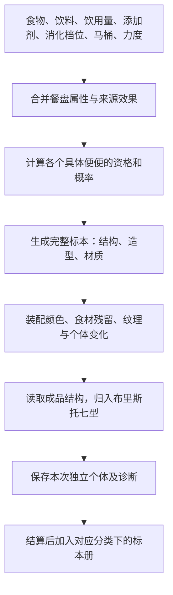

# 食物与便便产出算法说明报告

核对日期：2026-10-17。当前规则版本 `rulesVersion: 13`，存档版本 `saveVersion: 5`。

本报告按当前代码说明实际算法，供策划调参和开发对照。示例取核对当日的参数，后台保存新配置后应重新计算。食物效果属于游戏设定。

## 1. 当前模型：配方生成个体，按个体形态分类



每种便便有固定的结构与名称，每次产出另有独立身份。

| 字段                               | 含义                                              | 示例                    |
| ---------------------------------- | ------------------------------------------------- | ----------------------- |
| `specimenId`                       | 具体便便的稳定条目 ID，每个条目只有一个结构与分类 | `classic:4`，顺畅小能手 |
| `individualId`                     | 本次个体 ID，与单局 ID 一致                       | 开局生成的 UUID         |
| `morphology.form`                  | 实际结构，分类器读取此字段                        | `smooth-log` → 4 型     |
| `characterId`                      | 便便品种的稳定 ID                                 | `classic`               |
| `type`                             | 对结构分类后的布里斯托类型                        | `7`                     |
| `colorId` / `marks` / `appearance` | 本次颜色、印记、颗粒、气孔等表现快照              | 墨黑底色、金针菇印记    |

总共 [50 种便便、50 个图鉴条目](../src/content/specimen-blueprints.js)。每种只保留一个固定分类，例如顺畅小能手 classic:4 只属于 4 型、旱地裂纹条 cracked:3 只属于 3 型、摊平小煎饼 pancake:7 只属于 7 型。颜色、食材印记和重复产出的个体都不扩充品种数。

homeType 是该种便便唯一的固定分类，character.types 只含这一个值。每种只建立一个 blueprint，图鉴读取该条目的固定结构。

## 2. 输入与九项食物参数

[normalizeSelection](../src/game/selection.js) 规范输入：最多三种不重复的食物、一种饮料、最多三种添加剂、消化档位、一款马桶与停止指针后取得的力度值。无效输入回退默认值；食物解锁和马桶拥有由开局流程另行检查。

`water` 是当前饮料的总饮用量，四舍五入到 250 mL 步长，限制在 250–2500 mL，默认 1500 mL。

当前 51 种食物的数值保存在 [food-attribute-values.js](../src/content/food-attribute-values.js)。九项属性均为 1–7 整数，另有 `pigmentId` 色素 ID 或 `null`。

| 参数                     | 数字方向               | 实际作用                                     |
| ------------------------ | ---------------------- | -------------------------------------------- |
| `softness` 软硬程度      | **1 非常软，7 非常硬** | 决定结构的主要软硬倾向                       |
| `cohesion` 凝聚度        | 1 分散，7 连成整体     | 干硬方向修正、结构亲和度、连续或分散造型权重 |
| `elongation` 延展性      | 1 短小，7 长条盘卷     | 结构亲和度、造型权重、成形条体伸展           |
| `grain` 颗粒感           | 1 细腻，7 粗颗粒       | 表面颗粒密度与尺寸                           |
| `retention` 形态保留度   | 1 不显示，7 明显保留   | 逐个食材的可见残留，不参与餐盘平均           |
| `colorStrength` 染色能力 | 1 不染色，7 强染色     | 选择主要食物色素并控制染色比例               |
| `porosity` 蓬松度        | 1 紧实，7 多孔         | 气孔纹理、气泡标签与蓬松造型权重             |
| `lubricity` 顺滑度       | 1 阻滞，7 顺滑         | 顺畅度及部分长条造型权重                     |
| `influence` 影响强度     | 1 点缀，7 主导混搭     | 六项餐盘属性的相对权重及食物色素竞争         |

`softness` 表示当前食物的软硬程度，数值越大越硬。布里斯托方向相反：1 型为硬颗粒，7 型为水样，因此软硬方向转换为 `8 - softness`。

## 3. 多种食物如何共同生效

实现：[food-profile.js](../src/game/food-profile.js)、[effects.js](../src/game/effects.js)。

软硬、凝聚、延展、颗粒、蓬松、顺滑六项分别按影响强度加权：

```text
W = Σ 食物 influence
餐盘属性 X = Σ(食物 X × 食物 influence) / W
```

合并值可以是小数。食物先去重、排序，因此餐盘的摆放顺序不改变结果。

**影响强度是混吃时的相对权重。** 单吃时这份食物占 100%，提高它的影响强度不会放大所有效果；各食物权重同时按相同比例变化，也不改变占比。影响强度不会再乘一次印记保留度、标签或稀有倍率。

其他合并规则：

- 残留按食物逐个记录。除金针菇外，`retention > 1` 时保存 `{ foodId, retention }`；不同食物不会平均成匿名印记。金针菇使用独立印记。
- 有色素且染色能力大于 1 的食物，以 `colorStrength × influence` 竞争，最高者提供主要色素；同分按食物 ID 排序。染色强度取获胜食物本身的数值，不平均多种色素。
- 美术品种的基础来源仍按各食物 `appearanceId` 的数量投票，同分按 ID 排序；干燥、辣味、咖啡等来源规则可能优先匹配。这是候选素材来源，不是个体分类。

食物的营养参考 `traits` 用于内容资料与初始值，形态统一由九项属性控制。食品特定款式倍率、稀有加值和稀有倍率继续生效。

饮料、添加剂、马桶与力度的效果如下：

| 字段                      | 合并方式                                  |
| ------------------------- | ----------------------------------------- |
| `typeShift`               | 累加后限制在 −2 至 +3；正数偏软，负数偏硬 |
| `typeBalance`             | 累加，最多 2，先向柔软成形的结构靠近      |
| `formationStability`      | 累加，最多 0.18                           |
| `typeWeights`             | 对相应结构的权重加值                      |
| `smoothnessBonus`         | 与餐盘贡献 `(lubricity - 4) × 0.5` 累加   |
| `specialWeightBonus`      | 对符合资格的稀有候选基础权重加值          |
| `specialWeightMultiplier` | 稀有倍率相乘                              |
| `dropWeightMultipliers`   | 按品种 ID 对指定候选的倍率相乘            |
| `outcomeMarks`            | 注册印记合并去重                          |

标签合并用于来源资格；餐盘蓬松度达到 5 时增加 `bubbles` 标签。饮料效果不会按 mL 线性放大，饮用量使用下一节的分段规则。

## 4. 配方的结构亲和度

### 消化时间的研究依据与游戏映射

Degen 与 Phillips 对 32 位健康志愿者的研究发现，较硬的便便与较慢的结肠通过相关，较松散的便便与较快的结肠通过相关；未观察到形态与胃排空或小肠通过的对应关系。因此这里参考的是结肠停留与水分回收的方向，而不是把食物在胃里的时间当作产出形态。[1996 年研究](https://pubmed.ncbi.nlm.nih.gov/8881820/)

Lewis 与 Heaton 在 66 位志愿者中测量并干预全肠道通过时间，观察到通过时间变化与 Bristol 形态评分变化相关。这支持“通过较快偏软、较慢偏硬”的定性方向，不能推导出某个食物在固定小时后必然产出某型。[1997 年研究](https://pubmed.ncbi.nlm.nih.gov/9299672/)

游戏字段 `digestionTime` 取 `"2" / "4" / "8" / "random"`，默认 `"4"`。数字是压缩的游戏消化档位，不是现实小时数，也不增加玩家等待。

| 选项     | 形态偏移         | 说明                 |
| -------- | ---------------- | -------------------- |
| 2 · 短时 | typeShift +1     | 同餐盘更偏软         |
| 4 · 适中 | typeShift 0      | 保留配方原本倾向     |
| 8 · 较久 | typeShift −1     | 同餐盘更偏硬         |
| 随机     | 2 / 4 / 8 各 1/3 | 开始时抽取一次并冻结 |

上述数值是策划设定，合并饮料、添加剂与力度后仍受总偏移边界限制。时间不直接指定七型；仍然先生成具体个体，再按实际结构分类。不会清除金针菇必出印记，不增加稀有预算。

随机预告使用三种固定时间完整候选池的等概率混合，按 specimenId 汇总概率。实际开始时只抽一次时间档位，刷新不重抽；锁定力度时再用两次随机数生成个体和外观种子。结果仍在锁定后 400 ms 揭晓。

玩家点击开始后才显示力度指针。设开始后经过 `elapsed` 毫秒，`p = (elapsed % 3000) / 3000`，力度为 `round((p <= 0.5 ? 2p : 2(1-p)) × 100)`。指针在 1.5 秒从 0 移到 100，再用 1.5 秒回到 0，持续往复，点击停止才锁定。轻力度 0–33：`smoothnessBonus +0.5`、`formationStability +0.08`，提供 `low-force` 标签；中等力度 34–66：无额外效果；强力度 67–100：`typeShift +0.6`，提供 `high-force` 标签。候选条件 `forceZone` 可限制为 `low` / `medium` / `high`，例如螺旋要求轻力度，喷射要求强力度。力度会改变游戏概率，不保证特定产出。

游戏开局前的配方预告以 50 的中等力度计算；实际抽取以玩家停止时的力度计算。Admin 的模拟拉屎力度输入与游戏共用同一个 `force` 字段，范围 0–100。

实现：[recipe-shape.js](../src/game/recipe-shape.js)。以下是建立具体候选时使用的结构权重，计算过程不独立抽取分类。

设餐盘硬度为 `H`、凝聚为 `C`、延展为 `E`。连续值从 `t = 8 - H` 开始，叠加饮用量偏移：

| 规范后的饮用量 | 偏移 |
| -------------- | ---- |
| 250–500 mL     | −3   |
| 750–1000 mL    | −2   |
| 1250 mL        | −1   |
| 1500–2000 mL   | 0    |
| 2250–2500 mL   | +1   |

```text
如果 t < 4 且饮用量 >= 1000：
  t += min(4 - t, max(0, C - 4) × 0.4)

t += sign(4 - t) × min(abs(4 - t), typeBalance)
目标结构索引 T = clamp(Math.round(t + typeShift), 1, 7)
中心比例 p0 = min(0.95, 0.8 + formationStability)
```

目标结构先获得 `100 × p0` 权重，邻近结构平分剩余权重；端点只有一个邻居。默认中间结构为 `80 / 10 / 10`，端点为 `80 / 20`。再加上 `typeWeights`。

凝聚与延展的结构偏好为：

| 结构对应型 | 偏好凝聚       | 偏好延展       |
| ---------- | -------------- | -------------- |
| 1          | 1              | 1              |
| 2          | 3              | 3              |
| 3          | 5              | 5              |
| 4          | 6              | 6              |
| 5          | 3              | 2              |
| 6          | 2              | 2              |
| 7          | 不应用此项修正 | 不应用此项修正 |

对 1–6 对应结构：

```text
亲和度 = exp(-0.12 × abs(C - 偏好凝聚) - 0.09 × abs(E - 偏好延展))
修正权重 = 基础权重 × 亲和度
结构倾向 A = 修正权重 / 修正权重之和
```

水样结构的亲和度固定为 1。没有基础或额外权重的结构不会仅凭亲和度获得机会。此处的中心 80% 是中间权重，最终比例不一定仍为 80%。

## 5. 建立具体便便候选

实现：[outcome-pool.js](../src/game/outcome-pool.js)、[combinations.js](../src/game/combinations.js)。

基础品种来源按顺序匹配：饮用量不超过 750 mL → 干燥来源；辣椒或辣味标签 → 火纹来源；咖啡标签 → 豆纹来源；益生菌且至少 2000 mL → 泡沫来源；之后尝试绿色标签与餐盘的品种投票结果。偏好品种仅在固定分类匹配时使用；否则分别用七型基础品种 pebble、stacked-stones、cracked、classic、soft-pillows、mashed-potato、pancake，不改造同款的分类。基础候选权重为 100 × 该品种额外倍率；不再重复加入同一个品种的普通候选。

其他候选读取内容配置中的食物、饮料、添加剂、马桶、力度、水量和标签条件。所有配置条件必须同时满足，`tagsAny` 等列表内部按任一匹配。每个候选还必须有对应结构的实际素材与独立条目。

```text
普通候选原始权重
  = drop.weight × 指定候选倍率 × 造型属性倍率
```

造型属性倍率按美术品种 `art` 决定，匹配多条时相乘：

| art                                              | 倍率                                  |
| ------------------------------------------------ | ------------------------------------- |
| `spiral / rope / ribbon / curve / warm / spring` | `exp((E - 4) × 0.22 + (C - 4) × 0.1)` |
| `marbles / segments / pillows / mash / beads`    | `exp((4 - C) × 0.18)`                 |
| `bubbles / foam / cloud`                         | `exp((porosity - 4) × 0.25)`          |
| `rope / ribbon / curve`                          | 再乘 `exp((lubricity - 4) × 0.12)`    |

同结构下的普通权重等比例缩放到总和 100，再加入符合资格的稀有候选。`uncommon` 点缀也属于普通预算。

“一气呵成螺旋”对应 `spiral:4`，实际结构是连续柔软条体，固定归入 4 型，要求 0–33 的轻力度，基础权重 70；凝聚与延展提高其候选权重。锁定力度后约 0.4 秒揭晓结果。

## 6. 稀有资格与合计 0.5% 上限

| 材质品种 | 唯一固定分类 | 额外资格                             | 基础权重 |
| -------- | ------------ | ------------------------------------ | -------- |
| 黄金     | 4            | 至少 1000 mL，无辣椒、辣味、咖啡标签 | 0.1      |
| 晶体     | 3            | `crystal-source`                     | 0.025    |
| 彩虹     | 4            | `rainbow-source`                     | 0.025    |
| 果冻     | 5            | `gel-source`                         | 0.025    |
| 霜晶     | 2            | `frost-source`                       | 0.06     |
| 夜光     | 6            | `glow-source`                        | 0.04     |
| 陨星     | 1            | `star-source`                        | 0.06     |
| 琥珀     | 3            | `amber-source`                       | 0.06     |

表中的每种材质只有一个固定分类条目。黄金只有黄金传说 `gold:4`，固定 4 型。拥有所需来源只取得资格，不能保证产出。黄金没有强制金箔来源要求，满足形态、水量与排斥条件即可低概率进入；金箔来源为它提供额外倍率。

```text
稀有原始权重
  = max(0, 基础权重 + specialWeightBonus)
    × 配方倍率 × specialWeightMultiplier × 指定品种倍率
```

黄金另有西兰花＋益生菌＋1500–2000 mL 的配方倍率 1.5。所有倍率不能绕过资格条件。

每个结构组中，普通权重 `Cw = 100`，稀有总权重 `Rw`，上限 `c = 0.005`：

```text
稀有总权重上限 Rmax = Cw × c / (1 - c) ≈ 0.502512563
稀有缩放系数 = Rw > 0 ? min(1, Rmax / Rw) : 1
稀有候选权重 *= 稀有缩放系数
组内候选比例 Q = 候选权重 / 组内总权重
```

不足上限不会补足，超过上限按比例压缩稀有候选。随后为每个具体条目建立完整概率：

```text
P(具体标本 i) = 对应结构倾向 A × 该结构组内候选比例 Q_i
P(任意稀有) = Σ所有稀有标本 P_i <= 0.005
```

`getOutcomePool` 返回这些完整条目及概率，普通条目在前，各自按概率降序排序，同概率按条目 ID 排序。`specialProbability` 直接累加完整池中的稀有概率。

`getDropPool` 保留为开发者查看某结构组内条件比例的接口，游戏生成使用完整池。

## 7. 生成个体后再分类

[rollOutcome](../src/game/drops.js) 第一次随机从完整池选择一个具体条目，第二次随机记录 `variationSeed`，用于本次个体的表面布局和细微朝向。第二次随机不重抽分类。

标本装配 `morphology`、颜色、印记与纹理后，[classifySpecimen](../src/game/specimen.js) 读取实际结构：

| 实际结构                   | 分类 |
| -------------------------- | ---- |
| `hard-pellets` 分离硬粒    | 1 型 |
| `lumpy-log` 结块条体       | 2 型 |
| `cracked-log` 裂纹条体     | 3 型 |
| `smooth-log` 光滑柔软条体  | 4 型 |
| `soft-blobs` 清晰软块      | 5 型 |
| `mushy-fragments` 松散糊状 | 6 型 |
| `watery` 水样              | 7 型 |

同一个体的结构、插画和分类固定对应。改变颜色、附加金针菇印记或出现黄金材质，不会另外随机改变它的类型。

`typeDistribution` 遍历完整池，按 `classifySpecimen` 汇总概率；`resolveBristolType` 取最可能分类作预告。分类不参与单独抽签。

## 8. 食物影响怎样显示在便便上

颜色优先级为：稀有材质自身色 → 固定色条目的专属色 → 饮料色素 → 添加剂色素 → 获胜的食物色素 → 其他普通底色规则。

饮料或添加剂同时有多个色素标签时，顺序为陶土、火龙果、甜菜、莓果、墨汁、炭黑、奶白、琥珀、可可、绿色、咖啡。专属色、材质色及饮料/添加剂色素的强度取 7；食物色素使用对应食物的染色能力。

```text
普通主体染色比例 a = (colorStrength - 1) / 6
显示颜色 = 原味棕 × (1 - a) + 目标色 × a
```

主色和高光分别按 RGB 通道插值；不是把三种食物的颜色同时混合。

普通食材保留度 1 不显示印记，2–7 按以下规则显示食材小图案：

```text
数量 = 1 + floor((retention - 2) / 2)
尺寸 = 10 + retention × 2.2
不透明度 = 0.25 + retention × 0.085
```

金针菇的保留度大于 1 时确定性附加专属细丝印记，可叠加普通与稀有材质。保留度是显形程度，不是出现百分比。

颗粒感和蓬松度控制主体内的颗粒、气孔纹理。3/4 型条体按 `1 + (elongation - 4) × 0.025` 横向伸展；水样不会拉成长条。个体种子轻微调整纹理相位、残留位置和整体朝向，保持统一软陶风格。

诊断只描述已生成的软硬、成形、纹理、色泽和可见残留，不列详细来源或抽签日志。稀有演出只读取结果，不参与抽奖。未发现条目统一显示同一个剪影。

## 9. 独立保存与得分

[createAimingSession / lockSessionForce](../src/game/session.js) 将一局分为两个阶段。点击开始时创建单局 ID，保存配方与 `startedAt`，进入 `aiming`；此时 `force`、`outcome`、`lockedAt`、`endsAt`、`seconds` 都为 null，指针持续摆动，不能结算。点击停止时读取同一时刻的摆动值，设置 `force`、`lockedAt` 和 `endsAt = lockedAt + 400`，`seconds` 记录从开始到揭晓的实际总用时，生成并冻结完整结果，进入 `running`。单局 ID 同时作为 `individualId`。刷新继续相同摆动起点或冻结结果，后台调参、揭晓时间到达都不重抽。

结算后 [recordIndividual](../src/progression/individuals.js) 把本次个体追加到 `save.individuals`，保留自己的分类、颜色、印记、外观、序号、时间与配方。重复取得同种便便不会覆盖上一次，也不会把两次的印记合并成一只虚构标本。重复结算同一 ID 不再发放。

图鉴中的每个固定条目只出现在一种分类下，展开后逐个查看该条目下的独立个体。

当前开发存档只保存完整的 `individuals`，不维护并行收藏索引。缺少结构、条目身份、外观快照或个体 ID 的记录直接判为无效；`aiming` 单局保留摆动起点且没有结果；`running` 单局必须有完整冻结结果，读取时不会补抽。跨标签页的停止和结算使用同一浏览器锁，重复停止不会改写力度或重抽结果。

```text
类型 1–7 基础顺畅度 = [1, 2, 4, 5, 3, 2, 1]
总加成 = (餐盘顺滑度 - 4) × 0.5 + 其他来源 smoothnessBonus
顺畅度 = round(clamp(基础顺畅度 + 总加成, 1, 5))
分数 = round(min(100, 50 + 顺畅度 × 9 + 黄金额外 5 分))
```

黄金额外加分仅对 `characterId === "gold"` 生效，其他稀有材质不自动加这 5 分。

## 10. 完整例子：熟香蕉＋观音土

清水 1500 mL，无添加剂，经典白瓷马桶，中等力度。

| 参数       | 熟香蕉 | 观音土  |
| ---------- | ------ | ------- |
| 影响强度   | 6      | 7       |
| 硬度       | 3      | 6       |
| 凝聚       | 3      | 5       |
| 延展       | 3      | 3       |
| 颗粒       | 1      | 4       |
| 蓬松       | 1      | 1       |
| 顺滑       | 5      | 2       |
| 保留度     | 1      | 1       |
| 染色／色素 | 1／无  | 7／陶土 |

```text
H = (3×6 + 6×7) / 13 = 4.6153846154
C = (3×6 + 5×7) / 13 = 4.0769230769
E = 3，颗粒 = 34/13，蓬松 = 1，顺滑 = 44/13
初始结构值 = 8 - H = 3.3846153846
饮用量偏移 = 0，凝聚修正 = 0.0307692308
目标结构索引 = round(3.4153846154) = 3
```

结构亲和度修正后，对应 3、2、4 型的倾向分别约为 80.1129%、11.7698%、8.1173%。完整池中各个便便的最终概率为：

| 具体条目                      | 固定类型 | 整顿饭中的概率 |
| ----------------------------- | -------- | -------------- |
| 旱地裂纹条 `cracked:3`        | 3        | 80.112944%     |
| 香肠石块串 `stacked-stones:2` | 2        | 11.769770%     |
| 顺畅小能手 `classic:4`        | 4        | 5.187017%      |
| 香蕉弯弯 `banana-curve:4`     | 4        | 2.922160%      |
| 黄金传说 `gold:4`             | 4        | 0.008109%      |

稀有合计约 `0.0081092%`，并非一定达到 0.5%。只使用现有 50 种便便中的固定条目，不创建同款其他类型的分身。

向 `rollOutcome` 提供 `0.5、0.5`：第一个值选中旱地裂纹条，第二个值记录种子 500000。产出为 `cracked:3`、陶土浅灰、颗粒约 2.6154，无食材残留；由其 `cracked-log` 结构归为 3 型，顺畅度 4，得分 86。

单吃、其他条件相同的对照：熟香蕉偏向 5 型约 84.4803%；当前华莱士汉堡偏向 7 型约 83.1500%；金针菇偏向 4 型约 82.9081%，且保留度大于 1 时可见专属细丝。它们都由当前参数计算，不是食物名称对应的固定概率。

## 11. Admin 的预览口径

后台七型图表由完整池汇总，稀有率累加同一池的稀有条目。“代表外观”选择整体概率最高的普通标本，通过其抽签区间中点与固定种子生成，展示实际结构和印记。它是稳定预览，不是一次实际历史产出。

当前后台可选择三食物、饮料、水量、马桶和力度；添加剂预览仍固定为空，完整配方可在游戏或下方脚本验证。界面百分比保留一位小数，示例的 0.0881421% 会显示成 0.1%，计算精度未改变。

调参时固定其他条件，一次改变一个属性；某条目没有出现，先查来源资格、实际结构是否有权重，再查倍率。保存后刷新游戏，尚未生成结果的单局使用当前配置；已经停止指针并锁定的结果按快照恢复。开始时只保存配方选择，没有保存完整食物参数副本。

## 12. 可运行的开发核对脚本

在项目根目录执行，修改 `selection` 即可检查其他配方。该脚本调用生产算法，输出每个具体标本的概率、结构分类、整体稀有率和固定随机样本。

```sh
node --input-type=module <<'NODE'
import { normalizeSelection } from './src/game/selection.js';
import { collectEffects } from './src/game/effects.js';
import { getOutcomePool, rollOutcome, specialProbability } from './src/game/drops.js';
import { classifySpecimen, specimenName } from './src/game/specimen.js';
import { typeDistribution } from './src/game/stool-type.js';

const selection = normalizeSelection({
  foodIds: ['banana', 'guanyin-clay'],
  drinkId: 'water', water: 1500, additives: [],
  toiletId: 'standard', force: 50, digestionTime: '4',
});
const percent = value => `${(value * 100).toFixed(6)}%`;
console.log('餐盘合并效果', JSON.stringify(collectEffects(selection), null, 2));
console.table(getOutcomePool(selection).map(entry => {
  const type = classifySpecimen(entry);
  return {
    id: entry.specimenId,
    name: specimenName({ characterId: entry.characterId, type }),
    form: entry.morphology.form,
    type, special: entry.special, probability: percent(entry.probability),
  };
}));
console.table(typeDistribution(selection).map(entry => ({
  type: entry.type, probability: percent(entry.probability),
})));
console.log('整体稀有率', percent(specialProbability(selection)));
const draws = [0.5, 0.5];
console.log('完整个体样本', rollOutcome(selection, () => {
  if (!draws.length) throw new Error('奖励预期只使用两次随机数');
  return draws.shift();
}));
NODE
```

随机源必须返回 `[0, 1)` 内的有限数字。要精确命中某条目，先在完整池中累计它之前的概率，再加上它自身概率的一半；第二个值仅控制本次个体变化。

## 13. 代码索引

| 要查的问题                       | 文件                                                                                                                             |
| -------------------------------- | -------------------------------------------------------------------------------------------------------------------------------- |
| 参数定义、实际数值               | [food-attributes.js](../src/content/food-attributes.js)、[food-attribute-values.js](../src/content/food-attribute-values.js)     |
| 餐盘合并、来源效果               | [food-profile.js](../src/game/food-profile.js)、[effects.js](../src/game/effects.js)                                             |
| 结构定义、50 个固定条目          | [stool-forms.js](../src/content/stool-forms.js)、[specimen-blueprints.js](../src/content/specimen-blueprints.js)                 |
| 配方结构亲和度                   | [recipe-shape.js](../src/game/recipe-shape.js)                                                                                   |
| 来源资格、完整候选池、稀有预算   | [combinations.js](../src/game/combinations.js)、[outcome-pool.js](../src/game/outcome-pool.js)                                   |
| 生成个体、结构分类、概率预告     | [drops.js](../src/game/drops.js)、[specimen.js](../src/game/specimen.js)、[stool-type.js](../src/game/stool-type.js)             |
| 颜色、外观快照、实际绘制         | [color.js](../src/game/color.js)、[food-appearance.js](../src/game/food-appearance.js)、[stools.js](../src/ui/artwork/stools.js) |
| 单局冻结、独立标本归档、模型校验 | [session.js](../src/game/session.js)、[individuals.js](../src/progression/individuals.js)、[model.js](../src/storage/model.js)   |
| 图鉴与诊断                       | [collection.js](../src/ui/collection.js)、[explanation.js](../src/game/explanation.js)                                           |
| 后台代表预览                     | [admin.js](../admin/admin.js) 中的 `calculatePreview`                                                                            |

操作见 [食物调参指南](food-admin.md)，内容表见 [配方实验室手册](recipe-lab.md)。后续改规则时同步核对版本、示例和说明。本文与 Admin 不进入发布包；保存后的食物参数和标本生成规则进入运行时。
